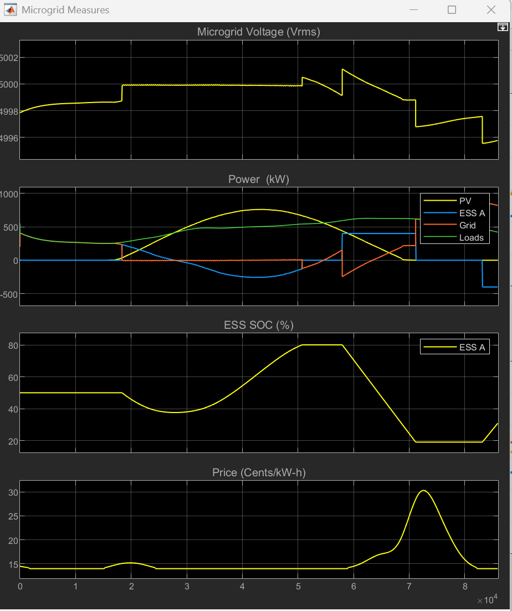
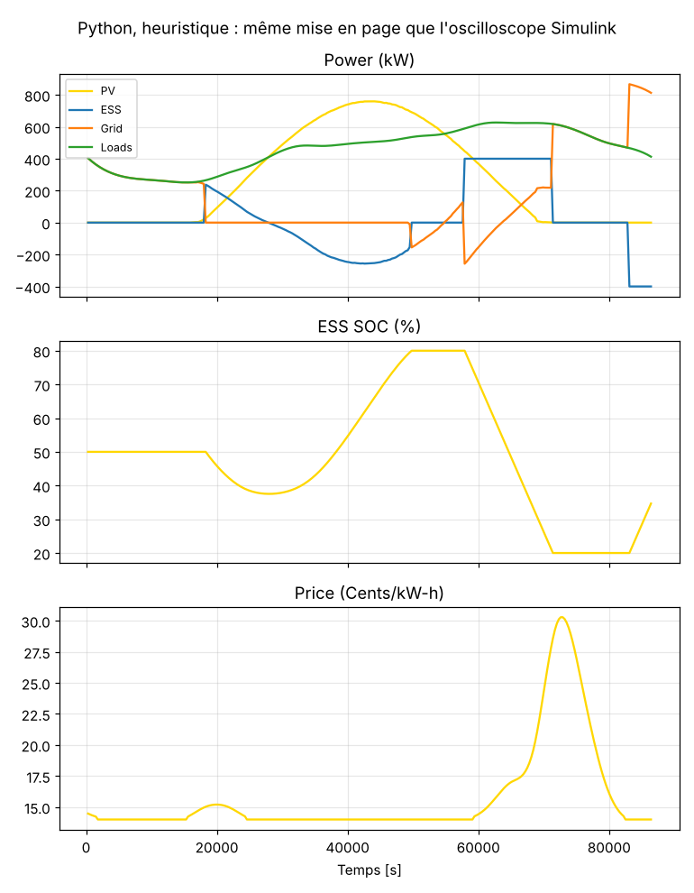
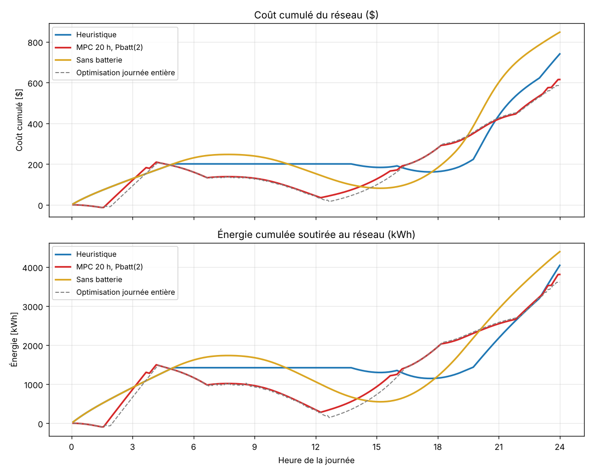

# Rejeu d'algorithmes de pilotage d'un micro-réseau

> **Travail personnel en cours.** Étude d'apprentissage sur le pilotage d'une
> batterie couplée à du photovoltaïque, menée pas à pas. Les marches 1 à 5 sont
> faites et validées ; la suite est décrite dans la [feuille de route](#feuille-de-route).

## Objectif

Comparer, sur les mêmes données, deux façons de piloter le stockage d'un site
équipé de photovoltaïque (PV) et d'une batterie :

1. une stratégie à base de **règles** (machine à états) ;
2. une **optimisation sous contraintes** qui minimise le coût d'achat
   d'électricité.

La comparaison se fait **par rejeu** : on rejoue une chronique passée, on
applique chaque stratégie et on compare les coûts. Aucun actif réel n'est
sollicité. C'est la première marche avant les essais avec le contrôleur dans la
boucle (CHIL, puis PHIL), puis le site pilote. C'est aussi la méthode du banc
d'essai académique [EMSx](https://arxiv.org/abs/2001.00450).

## Démarche

Le point de départ est l'exemple MathWorks
[*Microgrid Energy Management System (EMS) using Optimization*](https://github.com/jonlesage/Microgrid-EMS-Optimization)
(Jonathan LeSage). Il oppose une heuristique Stateflow à une optimisation
linéaire résolue par `linprog`.

Pour chaque marche, on suit le même ordre :

1. **tester l'existant** dans MATLAB/Simulink ;
2. **écrire la version Python**, ligne à ligne et commentée ;
3. **comparer** les deux résultats, puis consigner les écarts.

Le but est de disposer d'abord d'un double Python **fidèle** au modèle de
référence, défauts compris, avant de l'améliorer.

### Méthode de travail et transparence

- **MATLAB/Simulink** : j'ai exécuté moi-même le modèle d'origine et relevé les
  résultats. Les captures sont dans `results/simulink/`.
- **Python** : le code a été écrit avec l'aide d'un assistant d'IA (Claude),
  marche par marche, à partir de mon analyse du modèle MathWorks.
- **Validation** : chaque script Python est confronté aux résultats
  MATLAB/Simulink que j'ai obtenus, et les écarts sont consignés dans ce README.

L'objectif de ce dépôt est d'apprendre à comprendre, porter et vérifier des
algorithmes de pilotage. Ce n'est pas un logiciel de production.

## Résultats à ce stade

Journée de référence MathWorks (`pvLoadPriceData.mat`) : PV de 760 kWc, charge
de 250 à 630 kW, batterie de 2 500 kWh / 400 kW utilisée entre 20 et 80 % de
charge, pas de 5 min.

| Stratégie | Simulink (`compareCosts`) | Python | Fichier |
|---|---|---|---|
| Sans batterie | ≈ 840 $ | 847 $ | `marche2_parametrage.py` |
| Heuristique Stateflow | ≈ 735 $ | 741 $ | `marche4_regle.py` |
| Optimisation à information parfaite (`linprog`, un seul appel) | sans objet (*) | 586 $ | `marche3_optimisation.py` |
| Optimisation à horizon glissant (MPC, 20 h) | ≈ 640 $ | 615 $ | `marche5_mpc.py` |

Coûts en $, avec la même formule que Simulink : prix `costData + 5` en c$/kWh.
L'écart Python/Simulink d'environ 1 % vient du pas de 5 min, face à une
simulation électrique continue dans Simulink.

(*) Le script `energyOptimizationScript.m` (dossier *MATLAB only*) résout le même
problème. Le portage Python retrouve sa trajectoire et son coût optimal :
`dt·C'·Pgrid = 1,458171e11` en unités MATLAB.

### Validation contre Simulink

Les captures du modèle d'origine, exécuté sous MATLAB/Simulink, sont rangées
dans [`results/simulink/`](results/simulink/). Pour l'heuristique, on compare
l'oscilloscope *Microgrid Measures* à la même mise en page produite en Python :

| Simulink, mode Chart | Python, `marche4_regle.py` |
|---|---|
|  |  |

| Repère | Simulink | Python |
|---|---|---|
| SOC minimum du matin | ≈ 38 % vers 7 h 45 | 37,6 % vers 7 h 40 |
| SOC à 80 % (fin de l'absorption PV) | ≈ 14 h 00 | 13 h 45 |
| Fin de la décharge forcée | ≈ 19 h 45, SOC ≈ 19,5 % | 19 h 45, SOC 20 % |
| SOC final après la recharge de nuit | ≈ 31 % | ≈ 35 % |

Les petits écarts viennent du modèle de batterie. Simscape représente une
batterie électrique (tension, pertes) ; Python utilise un intégrateur idéal,
avec un rendement de 1.

Les autres captures : [`energyOptimizationScript.png`](results/simulink/energyOptimizationScript.png)
(cas *MATLAB only*, à comparer à `results/marche3_optimisation.png`) et
[`compareCosts.png`](results/simulink/compareCosts.png) (coûts cumulés des
trois stratégies).

### MPC contre optimisation sur la journée entière



La MPC (615 $) coûte un peu plus que l'optimisation résolue une seule fois sur
la journée (586 $), pour deux raisons :

- **Elle finit la journée avec plus d'énergie** : 667 kWh contre 500 kWh. Son
  horizon de 20 h dépasse minuit, et elle « voit » un lendemain identique,
  qu'elle prépare. L'optimisation sur la journée entière, elle, sait que tout
  s'arrête à minuit et vide la batterie. Valorisés à environ 14 c$/kWh, ces
  167 kWh représentent environ 23 $, soit la quasi-totalité de l'écart.
- **Son horizon est plus court en début de journée** : à 0 h, elle ne voit que
  jusqu'à 20 h.

L'écart avec Simulink (≈ 640 $) s'accumule surtout entre 16 h et 18 h, pendant
la recharge avant le pic : le modèle Simscape a des pertes, le modèle Python
n'en a pas. Appliquer `Pbatt(1)` ou `Pbatt(2)` ne change presque rien
(614 $ contre 615 $).

Les deux restent des **bornes optimistes** : la prévision y est parfaite. Une
vraie MPC travaillera avec des prévisions erronées (feuille de route).

### Ce que les marches ont appris

- **Mode d'appel du solveur.** Dans le modèle Simulink, `linprog` est appelé
  toutes les 5 min sur un horizon de 20 h, à partir du SOC mesuré : c'est une
  commande prédictive (MPC). Mais les « prévisions » sont les profils réels
  futurs, donc l'information est parfaite. Le script *MATLAB only* résout, lui,
  une seule fois sur la journée.
- **Solutions multiples.** Le prix est plat une grande partie de la journée et le
  rendement de la batterie vaut 1 : plusieurs plannings ont alors exactement le
  même coût. Le simplexe et les points intérieurs donnent le même optimum, mais
  des trajectoires différentes. D'où les oscillations observées dans MATLAB.
- **Piège du portage.** `scipy.optimize.linprog` impose `x ≥ 0` par défaut,
  alors que MATLAB laisse les variables libres : il faut écrire
  `bounds=(None, None)`.
- **Faiblesse de l'heuristique.** Elle vide la batterie entre 16 h et 19 h 45,
  selon l'horloge, et arrive vide au pic de prix de 20 h.
- **Comparaison inéquitable dans le modèle d'origine.** L'injection est payée au
  prix d'achat, sans limite. Il n'y a ni puissance souscrite, ni pertes, ni
  usure. L'analyse détaillée est dans
  [`docs/analyse_modele_reference.md`](docs/analyse_modele_reference.md).

## Arborescence

```
data/reference/   données et licence du modèle MathWorks (petite taille, versionnées)
docs/             analyse du modèle de référence
src/              code Python, un script par marche
results/          figures produites par les scripts Python
results/simulink/ captures du modèle MathWorks exécuté sous MATLAB/Simulink
```

Les données volumineuses téléchargées (`data/brut/`) ne sont pas versionnées :
voir `.gitignore`.

Le modèle Simulink `microgrid_WithESSOpt.slx` et les scripts MATLAB d'origine ne
sont pas recopiés ici. On les récupère dans le
[dépôt MathWorks](https://github.com/jonlesage/Microgrid-EMS-Optimization).
Il faut MATLAB avec Optimization Toolbox, Simulink, Simscape, Simscape
Electrical et Stateflow.

| Script | Rôle |
|---|---|
| `src/marche1_donnees.py` | lecture du `.mat`, profils PV, charge et prix |
| `src/marche2_parametrage.py` | paramétrage du cas *MATLAB only* (pas de 5 min, bornes batterie) |
| `src/marche3_optimisation.py` | portage de `battSolarOptimize` en `scipy.optimize.linprog` |
| `src/marche4_regle.py` | machine à états `HeuristicEMS` et simulateur de rejeu |
| `src/marche5_mpc.py` | MPC : optimisation relancée toutes les 5 min sur 20 h, comparaison des 4 stratégies |

## Lancer le code

Python 3.10 ou plus récent.

```
pip install -r requirements.txt
python src/marche1_donnees.py
python src/marche2_parametrage.py
python src/marche3_optimisation.py
python src/marche4_regle.py
python src/marche5_mpc.py
```

Chaque script affiche ses chiffres et enregistre sa figure dans `results/`.

## Feuille de route

- [x] Marche 1 : explorer les données de référence
- [x] Marche 2 : reproduire le paramétrage
- [x] Marche 3 : porter l'optimisation linéaire
- [x] Marche 4 : reproduire l'heuristique Stateflow
- [x] Marche 5 : MPC à horizon glissant de 20 h, comparée à Simulink
- [ ] Données réelles d'une semaine à Nantes : PV avec
      [PVGIS](https://joint-research-centre.ec.europa.eu/photovoltaic-geographical-information-system-pvgis_en),
      consommation tertiaire [Enedis Open Data](https://opendata.enedis.fr),
      prix spot [Ember](https://ember-energy.org/data/european-wholesale-electricity-price-data).
      Ordre de grandeur du site : 126 kWc de PV et 56 kWh de stockage.
- [ ] Optimisation MILP avec **Pyomo + HiGHS** : charge et décharge séparées
      avec rendements, binaire interdisant les deux à la fois, coût d'usure,
      prix de revente distinct, puissance souscrite
- [ ] Bornes de recharge de véhicules (IRVE) : d'abord subies, puis pilotées
- [ ] MPC avec **prévisions imparfaites**, pour un contrôleur réaliste
- [ ] Indicateurs : coût en €, dépassements de puissance souscrite, énergie
      cyclée, taux d'autoconsommation
- [ ] Rejeu des consignes Python dans le modèle Simulink (contrôleur dans la
      boucle)

## Références

- J. LeSage, *Microgrid Energy Management System (EMS) using Optimization*,
  MathWorks File Exchange,
  <https://github.com/jonlesage/Microgrid-EMS-Optimization>
- A. Le Franc, P. Carpentier, J.-P. Chancelier, M. De Lara, *EMSx: a numerical
  benchmark for energy management systems*, <https://arxiv.org/abs/2001.00450>
- Joshal et Gupta, *Microgrids with Model Predictive Control: A Critical
  Review*, Energies 16(13), 4851, 2023
- [CityLearn](https://github.com/intelligent-environments-lab/CityLearn)

## Crédits et licence

Les données `data/reference/pvLoadPriceData.mat` et la logique reproduite dans
les marches 2 à 4 proviennent de l'exemple MathWorks cité plus haut,
© 2019 The MathWorks, Inc., distribué sous licence BSD :
voir [`data/reference/LICENSE_MathWorks.md`](data/reference/LICENSE_MathWorks.md).
